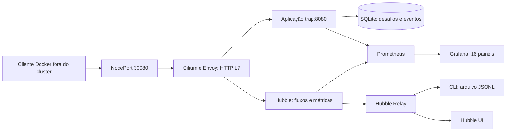

# Documentação técnica do laboratório de agentes externos

Documento elaborado em 14/10/2026 a partir do código, manifests, scripts e registros da validação da implementação. Descreve o estado implementado, suas decisões e limites. Os resultados de execução são históricos; a disponibilidade atual do cluster depende de ele continuar em execução.

A extensão implantada em 16/10/2026 adiciona clientes containerlab e acesso persistente na VM. Consulte [VM-192.168.122.131.md](VM-192.168.122.131.md) para essa topologia e seu procedimento de operação; o escopo original descrito abaixo permanece como histórico da primeira versão.

## 1. Problema e objetivo

O projeto investiga tráfego de rede relacionado a agentes de IA. Nesta implementação, o foco é o acesso de clientes externos a um serviço controlado pelo pesquisador, com dois objetivos: identificar declarações conhecidas no header HTTP `User-Agent` e observar como clientes respondem a diferentes estímulos presentes nas páginas recebidas.

O laboratório permite comparar navegação por link, cumprimento de instrução textual e resolução de uma transformação simples. Uma página sem estímulo funciona como controle.n. Os retornos são correlacionados por tokens individuais, permitindo medir resposta, repetição e atraso.

O resultado desta fase é uma infraestrutura de experimentação e coleta. Não foi implementado um detector que confirme IA ou classifique clientes como legítimos/ilegítimos. Também não há bloqueio automático nem integração com um provedor de modelos. Um header conhecido é uma declaração falsificável; um callback demonstra reação ao conteúdo, não a tecnologia que a produziu.

## 2. Escopo acordado e entregue

| Item | Implementação |
|---|---|
| Ambiente | Novo laboratório independente, cluster kind `agent-trap-lab` |
| Origem dos acessos | Clientes controlados na rede do laboratório, fora do Kubernetes |
| Armadilhas | Controle, link, instrução textual e transformação |
| Coleta de aplicação | Eventos JSON, SQLite, resumo, paginação e exportação |
| Coleta de rede | Cilium/Envoy HTTP L7, Hubble Relay, métricas e captura CLI |
| Visualização | Prometheus e Grafana com dashboard provisionado |
| Validação | Testes HTTP, cliente Docker externo, scrapes, consultas e manifests reais |
| Fora desta versão | HTTPS, exposição pública, integração containerlab, agente LLM real, inferência comportamental automática e autenticação de bots por IP |

O diretório `lab-prototipo-inicial` não foi modificado. O novo laboratório não depende de seus pods nginx ou políticas. Containerlab já faz parte do ambiente do projeto, mas não foi utilizado na validação desta implementação: a rede Docker do kind fornece o caminho externo necessário para o primeiro experimento.

## 3. Arquitetura e responsabilidades

O diagrama é lógico: detalhes de encaminhamento e tradução de endereços dependem do datapath do cluster. A comprovação relevante foi o tráfego externo observado como HTTP L7 no Hubble.

| Componente | Responsabilidade | Por que foi escolhido |
|---|---|---|
| Docker | Containers e rede local | Infraestrutura já presente; permite cliente externo ao cluster |
| kind | Kubernetes dentro de containers | Cluster reproduzível e independente do ambiente anterior |
| Cilium/eBPF | Datapath, contexto e políticas | Base do projeto de observação de rede |
| Envoy | Interpretação HTTP L7 | Headers e requisições HTTP precisam de processamento de aplicação |
| Hubble | Fluxos, contexto e métricas de rede | Complementa a coleta da aplicação com evidência de rede |
| Python stdlib | Servidor e lógica experimental | Sem dependências Python adicionais para este protótipo |
| SQLite | Estado e eventos persistentes | Simplicidade para uma instância e volume pequeno |
| Prometheus | Séries temporais e scrapes | Consulta e visualização de métricas HTTP e de rede |
| Grafana | Dashboard provisionado | Visualização pronta sem configurar painéis manualmente |

Cilium utiliza eBPF, mas a leitura de headers HTTP na configuração usada passa pelo Envoy. Hubble não extrai automaticamente headers de HTTPS criptografado fim a fim. Por isso o protótipo usa HTTP na rede fechada; uma futura versão HTTPS precisará definir onde ocorre a terminação TLS.

## 4. Decisões de infraestrutura

O arquivo [infra/kind.yaml](infra/kind.yaml) define um node control-plane Kubernetes `v1.34.0`, desabilita o CNI padrão e mapeia a porta de host `127.0.0.1:18080` para o NodePort `30080`. O diretório de dados do host é montado em `/var/lib/agent-trap-lab` no node.

[infra/cilium-values.yaml](infra/cilium-values.yaml) configura Cilium `1.20.2`, roteamento em túnel VXLAN, IPAM Kubernetes, kube-proxy mantido e Cilium Operator com uma réplica. Envoy, Hubble, Relay e UI ficam habilitados. As métricas incluem DNS, drop, TCP, flow e HTTP v2. A redação preserva `User-Agent` e remove outros headers da visibilidade configurada; query strings são redigidas.

[infra/workloads.yaml](infra/workloads.yaml) cria namespace, volume, aplicação, Service NodePort e CiliumNetworkPolicy. A política seleciona somente `app=trap` e permite todas as requisições HTTP na porta TCP 8080 com `http: [{}]`. Ela habilita interpretação L7 sem restringir agentes por header. Ainda é uma política de ingresso: outras portas não são automaticamente permitidas para esse workload.

[infra/observability.yaml](infra/observability.yaml) cria Prometheus, Grafana, armazenamento e provisioning. Prometheus coleta a cada 15 segundos: a aplicação, o próprio Prometheus e a porta 9965 dos pods Cilium descobertos no namespace `kube-system`. Seu ServiceAccount recebe permissão de leitura/listagem/watch de pods para descoberta.

Aplicação, Prometheus e Grafana possuem uma réplica e estratégia `Recreate`. Isso evita instâncias simultâneas usando o mesmo banco ou TSDB. Não é uma arquitetura de alta disponibilidade. Os volumes locais têm política `Retain`, afinidade com o node dedicado e dados no host; as capacidades declaradas nos PVs não impõem quotas reais de disco.

## 5. Fluxo de uma experiência

1. O cliente solicita `/experiment/<variante>`.
2. O servidor reconhece a declaração de UA, gera token e desafio aleatórios e persiste a emissão.
3. O HTML apresenta o estímulo correspondente; o controle não expõe seu token.
4. A requisição de exposição é registrada com status, duração e bytes produzidos.
5. Se o cliente executar uma nova requisição, `/probe/...` recupera o desafio e verifica tipo, resposta e validade.
6. Uma transação serializa a atualização do primeiro retorno, evitando contagem dupla entre threads.
7. O evento da tentativa é persistido e o resultado é devolvido em JSON.
8. Prometheus agrega o estado e os eventos por scrape; Grafana apresenta as séries.
9. Paralelamente, Hubble observa o tráfego HTTP selecionado pela política L7.

O token é gerado com `secrets.token_urlsafe(24)`, produzindo 32 caracteres. O desafio de transformação usa uma sequência hexadecimal aleatória. A validade padrão é 900 segundos a partir da emissão. Cache-Control `no-store` reduz reutilização da resposta pelo cliente; isso não garante que toda infraestrutura intermediária obedecerá ao header.

## 6. Variantes e interpretação

| Variante | Construção | O que investigar | Principal ambiguidade |
|---|---|---|---|
| `control` | Sem link ou instrução de callback | Referência sem estímulo | Não mede diretamente comportamento humano |
| `link` | Elemento HTML `a` com caminho de callback | Descoberta e navegação | Crawlers e prefetchers podem seguir links |
| `instruction` | Texto pedindo visita ao caminho, sem hyperlink | Resposta a uma instrução presente no conteúdo | Humanos e scripts também podem cumpri-la |
| `transform` | Inverter caracteres e completar o caminho | Processamento e construção de uma requisição | Um script convencional pode resolver o desafio |

O HTML de transformação fornece a sequência e o prefixo do caminho, mas não a URL completa já resolvida. A validação exige a inversão exata dos caracteres. As instruções estão em inglês no código atual; o idioma deve permanecer controlado e ser registrado nas futuras comparações.

Esses estímulos são intervenções ativas. Os dados obtidos não devem ser confundidos com observação passiva de comportamento natural. O texto de algumas páginas usa a expressão “passive observations”, mas a experiência contém um estímulo deliberado.

Instruções vindas de páginas também permitem estudar a fronteira entre conteúdo externo e comandos executados pelo agente. Nesta implementação, a ação solicitada limita-se a um GET no próprio serviço, com dados gerados pelo laboratório e sem efeito adicional.

## 7. Validação dos callbacks

| Outcome | Status | Significado |
|---|---|---|
| `success` | 200 | Primeiro retorno correto dentro do TTL |
| `repeat` | 200 | Novo retorno correto de um desafio já respondido |
| `expired` | 410 | Token conhecido com validade encerrada |
| `wrong_type` | 422 | Callback incompatível com a variante; inclui token de controle |
| `wrong_answer` | 422 | Transformação incorreta |
| `unknown_token` | 404 | Token com formato aceito, sem registro |
| `invalid_path` | 404 | Formato de callback inválido |
| `storage_error` | 503 | Falha de armazenamento durante o processamento |

Token expirado não se torna retorno válido por ter sido respondido anteriormente. Repetições não acrescentam amostras ao histograma de primeiro retorno. Um callback bem-sucedido não gera novos desafios.

## 8. Identificação pelo User-Agent

[app/main.py](app/main.py) contém catálogo com versão `2026-10-14`. Os marcadores são reconhecidos sem distinguir maiúsculas/minúsculas, com limites de token para evitar correspondências dentro de palavras maiores. O primeiro marcador reconhecido no catálogo determina a classificação.

| Provedor declarado | Marcadores | Categorias |
|---|---|---|
| OpenAI | `GPTBot`, `OAI-SearchBot`, `ChatGPT-User` | crawler, search, user_triggered |
| Anthropic | `ClaudeBot`, `Claude-SearchBot`, `Claude-User` | crawler, search, user_triggered |
| Perplexity | `PerplexityBot`, `Perplexity-User` | search, user_triggered |

Uma correspondência produz `identification_state=declared`; ausência produz `unknown`. Não há estado “IA confirmada” e não há consulta a feeds oficiais de IP. O header é limitado a 512 caracteres antes da classificação e armazenamento.

O provedor da exposição é armazenado no desafio; o provedor da tentativa é classificado de novo no callback. Eles podem ser diferentes. Os contadores de desafios retornados usam a declaração da exposição; contadores de tentativas usam a declaração da requisição de retorno. Isso evita assumir que ambas as requisições vieram do mesmo processo.

O IP armazenado é `client_address[0]`, o peer do socket. `X-Forwarded-For` é ignorado. Não é garantido que esse valor represente o cliente original após NAT ou proxy; o token é o principal identificador de continuidade experimental.

## 9. Modelo de dados e concorrência

| Tabela | Campos | Função |
|---|---|---|
| `challenges` | token, variant, challenge, created_at, expires_at, provider, first_return, valid_returns | Estado persistente das emissões e retornos |
| `events` | sequence, timestamp, data JSON | Histórico ordenado das requisições observadas |

SQLite usa WAL, conexões por operação e timeout de 15 segundos. O callback utiliza `BEGIN IMMEDIATE` para serializar leitura e atualização. `first_return` é preenchido uma única vez; `valid_returns` cresce também nos replays corretos. O teste concorrente usa 24 callbacks e verifica um único primeiro retorno.

O cálculo de métricas lê um snapshot do banco. Retornos únicos e atrasos derivam da tabela de desafios; tentativas, contagens HTTP e bytes derivam dos eventos. Essa escolha preserva primeiro retorno e atraso mesmo se o processo falhar após atualizar o desafio e antes de gravar o evento HTTP.

As duas gravações são transações separadas. Logo, existe uma janela em que uma tentativa/evento HTTP pode não ser registrada apesar de o retorno ter sido confirmado. Não há garantia de entrega exatamente uma vez para todos os eventos. Uma falha SQLite produz outcome limitado e a agregação tolera eventos antigos incompletos.

## 10. Interface HTTP

| Método/rota | Uso |
|---|---|
| GET `/` | Lista de variantes |
| GET `/experiment/<variante>` | Emissão de página experimental |
| GET `/probe/<token>` | Callback de link/instrução |
| GET `/probe/<token>/reverse/<resposta>` | Callback de transformação |
| GET `/healthz` | Processo respondendo |
| GET `/readyz` | Banco acessível por leitura |
| GET `/metrics` | Exposição Prometheus |
| GET `/api/summary` | Totais por variante e provedor da exposição |
| GET `/api/events` | Eventos JSON paginados |
| GET `/api/export` | Mesma paginação, com header para download |

As APIs de eventos aceitam `limit` de 1 a 1000 e `after` como sequência mínima exclusiva. A resposta contém `events`; utilize o último `sequence` para a próxima página. O nome “export” não significa exportação automática de todo o banco.

POST e outros métodos tratados pelo servidor não executam ações e devolvem 405. Rotas inexistentes não emitem tokens. A página inicial, probes, métricas e APIs de consulta via GET não geram eventos experimentais; métodos rejeitados e rotas inválidas podem gerar eventos.

## 11. Métricas e painel

A referência completa de nomes está no [README](README.md#eventos-e-métricas). Histogramas são expostos como `_bucket`, `_sum` e `_count`. Os limites dos buckets são 0,005; 0,01; 0,025; 0,05; 0,1; 0,25; 0,5; 1; 2,5; 5; 10; 30; 60; 300; 900 segundos e infinito. O histograma de atraso começa zerado para todas as variantes.

Os labels têm vocabulário controlado: variante, provedor, categoria, estado declarado, outcome, rota normalizada, método e status. Tokens, respostas do desafio, IPs e UAs completos ficam nos eventos, não nas séries. Isso evita criar uma série por cliente ou token.

O dashboard possui 16 painéis e 17 consultas: exposições; retornos únicos; fração de retorno; outcomes; atraso p50/p95; requisições HTTP; latência HTTP p95; bytes; declaração de UA; eventos persistidos; saúde de scrapes; SQLite; HTTP Hubble; latência Hubble; vereditos de fluxos; descartes de rede.

Contagens e frações de desafios são acumuladas desde o estado persistido. Os quantis de atraso também usam histogramas acumulados para testes esparsos. Taxas HTTP e parte das métricas de rede usam janelas temporais. Portanto, nem todo painel se restringe ao intervalo selecionado no Grafana.

Uma fração de retorno não é acurácia de detecção: inclui emissões recentes ainda sem chance de resposta, retornos de scripts e diferenças de tarefa. Da mesma forma, contagens Hubble não devem ser somadas às contagens da aplicação; Hubble pode observar probes, scrapes e eventos request/response separados.

`lab_service_up=1` só existe quando o scrape da aplicação responde. Para detectar indisponibilidade, observe `up{job="trap"}` e ausência de séries. `lab_db_ready` testa leitura do banco, não garante que todas as gravações futuras terão sucesso.

## 12. Automação e mapa dos arquivos

| Arquivo | Responsabilidade |
|---|---|
| `app/main.py` | Servidor, HTML, catálogo, SQLite, eventos e métricas |
| `tests/test_app.py` | Casos HTTP, concorrência, persistência e falhas |
| `Dockerfile`, `.dockerignore` | Imagem local da aplicação e contexto de build |
| `infra/kind.yaml` | Node, rede, portas e montagem de dados |
| `infra/cilium-values.yaml` | Valores Helm Cilium/Hubble |
| `infra/workloads.yaml` | Aplicação, armazenamento e política L7 |
| `infra/observability.yaml` | Prometheus, Grafana, volumes e provisioning |
| `infra/grafana/dashboard.json` | Definição versionada dos painéis |
| `scripts/tools.sh` | Download local das CLIs e checksums |
| `scripts/up.sh` | Criação/reaplicação do cluster e serviços |
| `scripts/node-ip.sh` | IP do node especificamente na rede Docker kind |
| `scripts/external-client.sh` | Cliente Docker de smoke fora do cluster |
| `scripts/observe.sh` | Relay em loopback e captura JSONL |
| `scripts/destroy.sh` | Remoção do cluster dedicado, preservando dados |
| `tools/smoke.py` | Fluxo determinístico das quatro variantes |
| `tools/check_observability.py` | Saúde dos alvos e consultas Grafana por API |
| `Makefile` | Atalhos de execução |
| `.gitignore` | Exclusão de estado, banco e artefatos locais |
| `README.md` | Guia operacional |
| `VALIDACAO.md` | Resultados históricos e limites da execução |

O provisionamento verifica pré-requisitos, prepara `.state`, recusa adoção de cluster de mesmo nome sem o kubeconfig esperado, cria kind sem esperar CNI, instala Cilium, faz build/load da imagem, aplica manifests, cria segredo Grafana e ConfigMap do dashboard, reinicia deployments e aguarda rollouts.

Credenciais e caches Helm ficam locais. O kubeconfig global não é atualizado pelo script. `make up` não é totalmente sem efeitos quando reaplicado: reinicia os três serviços e pode haver interrupção temporária. Os dados são preservados.

## 13. Uso, configuração e persistência

O roteiro executável está em [README.md](README.md#executar). Principais comandos: `make tools`, `make test`, `make up`, `make external-client`, `make grafana`, `make prometheus`, `make hubble-ui` e `make observe`. Execute-os no diretório deste laboratório.

| Configuração da aplicação | Padrão | Onde alterar |
|---|---|---|
| `PORT` | 8080 | Ambiente do processo; serviços/probes/política devem acompanhar |
| `DB_PATH` | `/data/events.sqlite3` | Ambiente; volume precisa acompanhar |
| `TOKEN_TTL_SECONDS` | 900, intervalo permitido 1–86400 | Ambiente do container |

O Dockerfile fornece defaults; os manifests atuais não expõem parâmetros por Helm para a aplicação. Para mudança persistente, adicione `env` ao deployment em `infra/workloads.yaml` e reaplique `make up`. Mudanças no catálogo ou nas variantes exigem edição do código, testes e rebuild/load.

Dados persistentes ficam em `.state/node-data/trap`, `.state/node-data/prometheus` e `.state/node-data/grafana`. Não basta copiar somente o arquivo SQLite durante escrita: utilize backup SQLite ou pare a aplicação antes de copiar seu diretório com WAL/SHM. Guarde evidências exportadas por execução.

`make destroy` invoca `scripts/destroy.sh --confirm`, removendo somente o cluster dedicado e seu kubeconfig local. Dados e binários locais permanecem. A aplicação continua disponível enquanto o cluster funciona; Grafana, Prometheus, Relay e UI acessados por port-forward dependem dos processos correspondentes em execução. Encerrar o terminal do port-forward pode encerrar esse acesso, sem remover o cluster.

## 14. Como executar uma avaliação com agentes reais

1. Escolha agentes conhecidos e controles negativos: crawler convencional, script HTTP e navegador humano.
2. Registre modelo/versão, tarefa, ferramentas, permissões, idioma, UA e identificação da execução.
3. Distribua variantes de forma equilibrada, idealmente aleatória. O servidor atual não faz randomização nem registra metadados de execução automaticamente.
4. Dê ao agente a tarefa de ler o conteúdo; não solicite diretamente o callback fora da página.
5. Inicie captura Hubble antes dos acessos e registre horários/falhas de coleta.
6. Execute repetições, evitando misturar tarefas ou condições diferentes na mesma comparação.
7. Aguarde o TTL para encerrar a janela de oportunidade antes de classificar ausência de retorno.
8. Exporte eventos com paginação e guarde a configuração usada, separando smoke sintético de execução real.
9. Compare retorno, erro, repetição e atraso por coorte; não trate “não retornou” como prova de ausência de IA.

Um token correlaciona conteúdo emitido e requisição subsequente, mas a página pode ser compartilhada ou processada por outro serviço. A identificação de um mesmo agente não deve depender apenas de IP ou token. O protocolo acima é uma proposta de evolução experimental, não uma avaliação já realizada.

## 15. Validação realizada e próximos passos

Os detalhes estão em [VALIDACAO.md](VALIDACAO.md): dez testes passaram; tráfego Docker externo percorreu o NodePort; Hubble observou HTTP e UA; três alvos Prometheus ficaram saudáveis; consultas dos 16 painéis passaram por API; a reaplicação preservou os dados; manifests e configuração Prometheus foram validados contra componentes reais.

Foram corrigidos problemas descobertos em execução: espera de Ready antes do CNI, número de réplicas do Operator, conflito TSDB durante rollout, evento incompleto após erro SQLite e ausência inicial de histograma. Nenhuma medição de eficácia de detecção foi produzida. Não houve inspeção visual do dashboard, teste de carga prolongada, reinicialização do host ou execução de LLM real.

As extensões prioritárias são metadados/coortes por execução, randomização das variantes, integração de agentes reais, integração containerlab, terminação TLS, verificação oficial de origem e coleta contínua com monitoramento de perdas. Antes de um uso maior, considerar retenção, backup, autenticação das APIs administrativas e agregação incremental de métricas: atualmente o scrape percorre os eventos acumulados no SQLite.

## 16. Referências e rastreabilidade

Esta documentação descreve a implementação local. Para fundamentos dos componentes, consulte [Cilium em kind](https://docs.cilium.io/en/stable/installation/kind/), [visibilidade L7](https://docs.cilium.io/en/stable/observability/visibility/), [políticas L7](https://docs.cilium.io/en/stable/security/policy/layer7/) e [métricas Hubble](https://docs.cilium.io/en/stable/observability/metrics/). O catálogo se baseia nas referências de [OpenAI](https://developers.openai.com/api/docs/bots), [Anthropic](https://support.claude.com/en/articles/8896518-does-anthropic-crawl-data-from-the-web-and-how-can-site-owners-block-the-crawler) e [Perplexity](https://docs.perplexity.ai/docs/resources/perplexity-crawlers) já utilizadas na pesquisa do projeto; nenhuma dessas fontes substitui autenticação do cliente nesta implementação.
